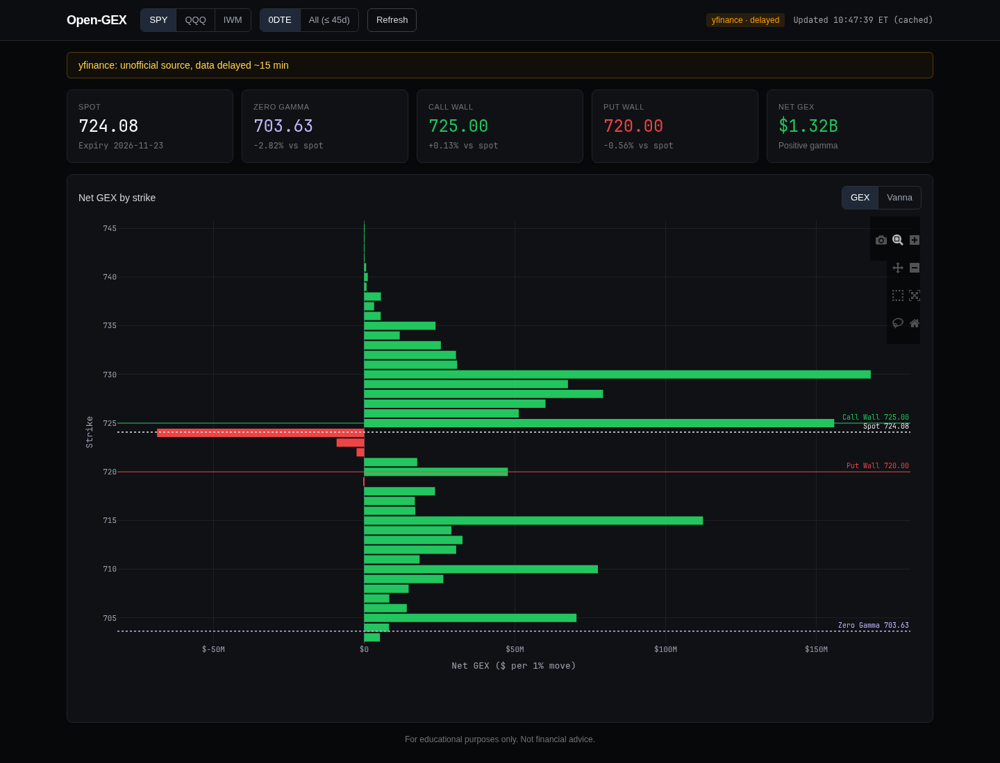

# Open-GEX

Open-source dashboard that estimates **dealer positioning in options** for day trading
**SPY, QQQ and IWM**: Gamma Exposure (GEX), Vanna Exposure (VEX), the Zero Gamma
(gamma flip) level and the Call / Put Walls.



## Features

- Net GEX and net Vanna by strike, as a horizontal bar chart (Plotly), with Spot,
  Zero Gamma, Call Wall and Put Wall lines.
- KPI cards: spot, Zero Gamma, Call Wall, Put Wall (each with its distance to spot),
  total net GEX and net VEX (positive / negative regime) and net Charm per day
  (whether dealers' hedging buys or sells into the close).
- Volatility strip: ATM implied volatility against 20-day realized volatility (ratio
  and spread), and the 1-day expected move, also drawn as two dotted lines on the chart.
- On-demand **3D vanna surface** ("Analyze 3D Vanna Surface" button): net VEX over
  simulated spots and IV shocks, computed only when asked so that the dashboard
  itself stays fast.
- Two expiry filters: **0DTE** (today's expiry, or the next one after the close, on
  weekends and holidays) and **All** (every expiry up to 45 days).
- Data from **Alpaca** (free paper account) or **Massive** (formerly Polygon.io) when
  keys are configured, with an automatic, clearly flagged fallback to **yfinance**.
- 15-minute disk cache, auto-refresh every 5 minutes, dark "trading desk" theme.
- Greeks recomputed for every contract with the same Black-Scholes-Merton
  assumptions, whatever the data source.

## Quick start

Requires Python 3.11+.

```bash
python -m venv .venv
source .venv/bin/activate          # Windows: .venv\Scripts\activate
pip install -r requirements.txt
cp .env.example .env               # optional: add your Alpaca or Massive keys
python app.py
```

Then open <http://127.0.0.1:5000>.

## Data sources

| Source | When | Notes |
|---|---|---|
| [Alpaca](https://alpaca.markets) | `ALPACA_KEY` and `ALPACA_SECRET` are set | Tried first. A free paper account is enough: the `indicative` feed gives quotes but **no IV**, so the IV is solved from each option price (see below). Open interest comes from the Trading API, the spot from the latest IEX trade. |
| [Massive](https://massive.com) (formerly Polygon.io) | `MASSIVE_API_KEY` is set | Requires a plan **with options data** (Options Starter or higher). The `timeframe` reported by the API (`REAL-TIME` or `DELAYED`) is shown in the UI. |
| [yfinance](https://github.com/ranaroussi/yfinance) | No key, or the sources above failed | **Unofficial** Yahoo Finance scraper, data **delayed ~15 min**, may break without notice. One request per expiry, so the first load of the *All* filter takes a few seconds. |

If a source fails (invalid key, no options plan, rate limit, timeout, bad response),
the app logs a warning, shows it in the UI and tries the next one. If yfinance
fails too, the API returns `502` and the UI shows the error. No synthetic data is
ever generated.

## Methodology

### Greeks

Black-Scholes-Merton with a continuous dividend yield `q` (per ticker, see
`config.py`), risk-free rate `r`, implied volatility `σ` from the source and
standard normal density `φ`:

```
d1    = (ln(S/K) + (r − q + σ²/2)·T) / (σ·√T)
d2    = d1 − σ·√T
Gamma = e^(−q·T) · φ(d1) / (S · σ · √T)          (same for calls and puts)
Vanna = −e^(−q·T) · φ(d1) · d2 / σ               (∂Delta/∂σ, same for calls and puts)
Charm = q·e^(−q·T)·N(d1) − e^(−q·T)·φ(d1)·(2(r−q)·T − d2·σ·√T) / (2T·σ·√T)
                                                  (∂Delta/∂t as time passes, call; the put's
                                                   is the call's minus q·e^(−q·T))
```

**Implied volatility (Alpaca only).** The option price is the quote mid
`(bid + ask) / 2`; with a one-sided or empty book it falls back to the last trade,
then the day's close. The IV is the `σ` where the BSM price above equals that price,
solved with Brent's method (`scipy.optimize.brentq`) in `[0.01 %, 1000 %]`. A price at
or below intrinsic value, or with no root in that range, leaves the IV empty and the
contract is dropped. Because `T` is calendar time, a 0DTE IV before the open looks
high (the price covers the whole session); Gamma only depends on `σ·√T` and is not
affected.

`T` is the time to the 16:00 New York close of the expiry day, in years
(365-day basis), floored at 15 minutes so that Greeks stay finite near expiry.
Greeks are always recomputed from the IV, even when the source provides its own.

### Exposures

**Dealer assumption:** dealers are long the calls and short the puts held in the
open interest. `sign = +1` for calls, `−1` for puts.

```
GEX = sign × Gamma × OI × 100 × S² × 0.01   → $ of delta per 1 % move of the underlying
VEX = sign × Vanna × OI × 100 × S  × 0.01   → $ of delta per +1 volatility point
CEX = −sign × Charm × OI × 100 × S / 365    → $ dealers buy (+) or sell (−) per calendar day
```

**Reading the net Charm:** unlike GEX and VEX, its sign is the dealers' hedge flow,
not their exposure, so that green always reads as buying pressure. Positive (green):
the dealers' delta shrinks as time passes and they **buy** the underlying back (typical
when out-of-the-money options dominate, since their deltas decay toward 0). Negative
(red): their delta grows and they **sell**. The flow builds up over the session and is
largest into the close and on expiry days.

Exposures are summed per strike across all selected expiries (`call_gex`,
`put_gex`, `net_gex`, `net_vex`), plus chain-wide totals (net Charm is a total only).

### Key levels

Computed on the whole cleaned chain (strikes within spot ± 30 %), not only on the
displayed range:

- **Call Wall:** strike with the largest call GEX.
- **Put Wall:** strike with the largest absolute put GEX.
- **Zero Gamma:** computed from a **profile**, not from cumulative strikes. Total
  GEX is re-evaluated on a grid of 201 hypothetical spots between −10 % and +10 %,
  recomputing every contract's Gamma at each spot with IV, T, r and q held
  constant (**sticky strike**). Sign changes are linearly interpolated and the one
  closest to spot is kept. If the profile never changes sign, the level is reported
  as *Out of range*.

### Cleaning

Contracts are dropped if they have missing values, open interest ≤ 0, an IV outside
[1 %, 300 %], a strike outside spot ± 30 %, or have already expired.

### Volatility and expected move

- **ATM IV:** mean of the call and put IV at the strike closest to spot, on the
  shortest expiry of the cleaned chain. Chain IVs are calendar-time (`T` to the
  16:00 close, 365-day basis). On a 0DTE that reads about 2.3× a session-based IV,
  because the option prices a whole session in a few calendar hours. The option's
  total variance `σ²·T` is therefore spread over the trading sessions left until
  the expiry (the rest of today's session plus each later weekday):
  `IV_ATM = σ · √(T · 252 / sessions)`.
- **Expected move (1 day):** `EM = S · IV_ATM · √(1/252)`, shown as `±$EM` and as the
  bounds `S ± EM`.
- **Realized volatility (20 days):** `std(log returns) · √252` over the last 20 daily
  returns of completed sessions (21 adjusted closes from Alpaca, or yfinance as a
  fallback, downloaded once per ticker and day).

### Vanna surface

Total net VEX of the cleaned chain on a 20 × 20 grid: simulated spots from −10 % to
+10 % around spot, and IV multipliers from ×0.80 to ×1.20. Every contract keeps its
strike, `T` and open interest (sticky strike); its IV is scaled by the shock and the
spot is replaced by the simulated one, with the same Vanna and VEX formulas as above.
At the current spot and an unshocked IV, the surface equals the dashboard's net VEX.
A full 45-day chain takes about 50 ms.

## Known limitations

- **Open interest is published once a day** and reflects the previous close.
  Positions opened during the session, which dominate 0DTE flows, are invisible.
- The **dealer long calls / short puts** assumption is a simplification: real
  dealer inventory is unknown and varies by strike and over time.
- **European** Black-Scholes is applied to **American** options on ETFs (early
  exercise is ignored).
- Rates and dividend yields are **static** values from `config.py` / `.env`.
- Outside regular trading hours (pre-market in particular), Yahoo often reports
  zero open interest and placeholder IVs: the yfinance chart is then empty and the
  UI says so. Use the dashboard during the session.
- yfinance data is unofficial and delayed; Massive data may be delayed depending
  on your plan.
- The session count behind the ATM IV ignores exchange holidays and half days. This
  only matters when the shortest expiry spans a holiday, which for daily expiries
  happens outside the session.

## Configuration

Environment variables (`.env`):

| Variable | Default | Description |
|---|---|---|
| `ALPACA_KEY` / `ALPACA_SECRET` | *(empty)* | Alpaca API key pair (a paper account works). Sent only in headers. |
| `ALPACA_FEED` | `indicative` | Options feed: `indicative` (free) or `opra` (paid plan and signed OPRA agreement). |
| `ALPACA_TRADING_URL` | `https://paper-api.alpaca.markets` | Trading API used for open interest; use `https://api.alpaca.markets` with live keys. |
| `MASSIVE_API_KEY` | *(empty)* | Massive API key with options access. Sent only in the `Authorization` header. |
| `MASSIVE_BASE_URL` | `https://api.massive.com` | Massive API base URL. |
| `RISK_FREE_RATE` | `0.04` | Annual risk-free rate (decimal). |
| `FLASK_DEBUG` | `0` | Set to `1` to enable the Flask debugger (local development only). |

Every other parameter (tickers, cache TTL, strike ranges, Zero Gamma grid, IV
bounds, dividend yields, host and port...) lives in [`config.py`](config.py).

### API

- `GET /api/gex?ticker=SPY&expiry=0dte` (`expiry` is `0dte` or `all`): exposures,
  levels and metadata as JSON, plus `total_charm` ($ of delta per day), `atm_iv`,
  `realized_vol` (decimals), `expected_move` ($), `expected_move_pct` (%), `em_upper`
  and `em_lower`. Returns `400` on invalid parameters and `502` if no data
  source is available.
- `GET /api/vanna-surface?ticker=SPY&expiry=all` (`expiry` is `0dte` or `all`, as
  for `/api/gex`): `{"x": spots, "y": IV multipliers, "z": net VEX}`, with one row of
  `z` per IV multiplier. Same `400` / `502` errors as above.
- `GET /api/health`: `{"status": "ok"}`.

## Tests

```bash
pytest
```

The tests never touch the network: data sources are mocked.

## License

[MIT](LICENSE)

## Disclaimer

Open-GEX is provided for **educational and informational purposes only**. It is
**not financial or investment advice**, nor a recommendation to buy or sell any
security. The data and calculations are provided "as is", with **no guarantee of
accuracy, completeness or timeliness**. Trading options involves a **substantial
risk of loss**. You alone are responsible for your trading decisions and for
complying with the terms of use of the data providers you connect (Massive, Yahoo
Finance).
